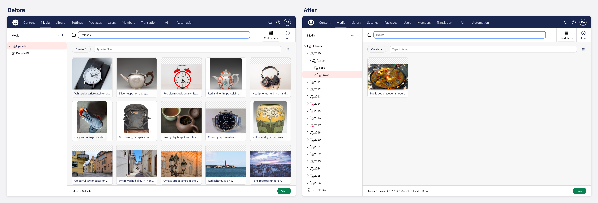
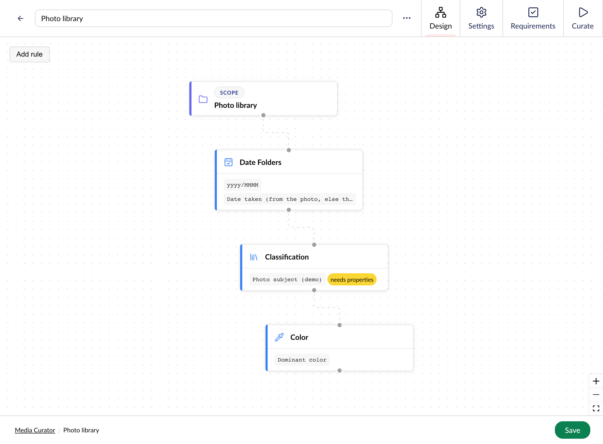
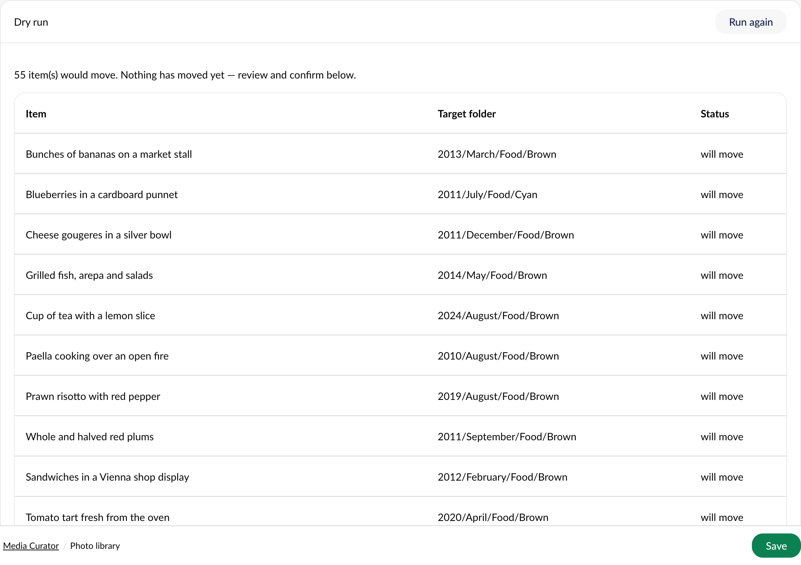
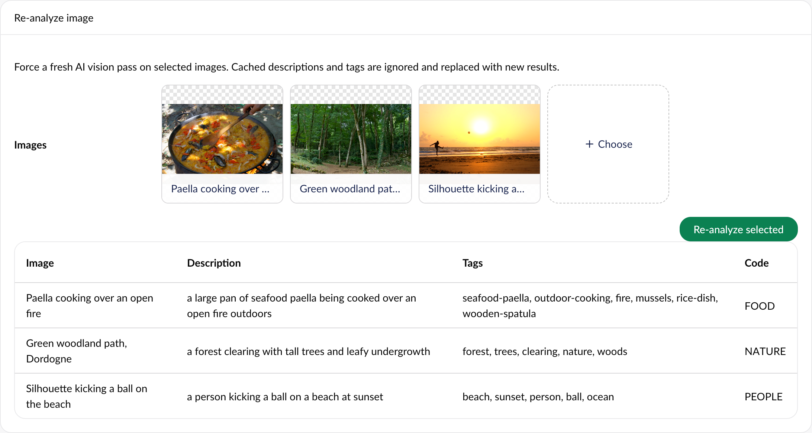

# Umbricians Media Curator

[](https://www.nuget.org/packages/Umbricians.MediaCurator)
[](https://github.com/Umbricians/Media-Curator/actions/workflows/build.yml)

Media Curator keeps your Umbraco media library organised. Editors upload images wherever is quickest, and before long
the Media section is one long list nobody can find anything in. Media Curator sorts those images into the folders
you want: by date, by shape and size, by file type, by colour, by camera details, or by what the picture shows.

You design the folder structure once, in a visual editor, and attach it to any media folder. Then Media Curator:

- **shows you where every image will go** before anything moves, so there are no surprises;
- **keeps every link working**, because it moves images the same way Umbraco does when an editor drags them;
- **can undo any run** with one click, from a log of everything it has moved;
- **can use AI to describe and tag images**, through [Umbraco.AI](https://www.nuget.org/packages/Umbraco.AI) and the
  AI provider you already use, or work without AI at all;
- **marks images that show people**, and the folders that contain them, so you can check consent or model releases.

It suits teams with a large or growing image library, sites that brought thousands of images over from another
system, and anyone who needs to know which of their images show people. Run it on a folder whenever you like, or add
the Automate package to sort each image as it is uploaded.

Works with Umbraco 17 and 18. Umbraco 19 support is in pre-release packages while Umbraco 19 is a release candidate.



## Documentation

- **[Getting started](docs/getting-started.md)**: install, first use, configuration, and what to check before going
  live.
- **[People detection](docs/people-detection.md)**: mark images that show people in the media tree.
- **Providers**: see [Built-in providers](#built-in-providers).

## Installation

```bash
dotnet add package Umbricians.MediaCurator
```

Restart the site. No configuration is needed to get started; Media Curator's database tables are created on startup.

On a site with [Umbraco.Automate](https://www.nuget.org/packages/Umbraco.Automate),
[Umbricians.MediaCurator.Automate](https://www.nuget.org/packages/Umbricians.MediaCurator.Automate) adds Media Curator
triggers and actions to workflows, such as curating each image as it is uploaded:

```bash
dotnet add package Umbricians.MediaCurator.Automate
```

Each package version is for one Umbraco major: 17.x for Umbraco 17.8.2 or later, 18.x for Umbraco 18.3.2 or later.
NuGet picks the right one for the site.

## Permissions

Media Curator adds no permissions of its own. Its screens are in the Settings section, and every part of it, including
**Curate images** on media folders, needs access to Settings.

Its API refuses changes that a browser says come from another site, or from another subdomain of yours, unless they
come from the `Umbraco:CMS:Security:BackOfficeHost` you've configured. The backoffice itself and scripts or servers
calling the API aren't affected.

## Features

- **Scoped rulesets**: attach a ruleset to any media folder; the nearest one above an image applies.
- **Nested, conditional rules**: each rule contributes folder levels, and child rules can depend on the parent's
  value. You edit them in a visual designer with live example paths.
- **Property provisioning with consent**: providers declare the media type properties they need, and Media Curator
  adds them only after you approve. Uninstalling never removes schema or data.
- **Safe by design**: a preview before anything moves, an activity log with one-click undo, exclusions, and only images
  are ever touched.
- **Built for large libraries**: "Curate images" on a folder with more than 100 images (at any depth) skips the
  preview and runs in the background, with progress in a notification and in the activity log. Curating 10,000 images
  in one flat folder takes about nine minutes on a development machine, with no AI involved.
- **AI on your terms**: recognition uses [Umbraco.AI](https://www.nuget.org/packages/Umbraco.AI) with any configured
  provider, results are cached per image, and AI can be switched off entirely. Classification decisions can optionally
  use TypeSafe's Jev.
- **People detection**: analysis can also decide, from the stored description and tags, whether each image shows
  people. The media tree marks those images and every folder above them, for privacy or model-release review.

The rule designer, here sorting photos by the date they were taken, then what they show, then their colour:



The preview, before anything moves:



What the AI said about three of the photos:



## Built-in providers

- [Date Folders](docs/providers/date-folders.md): builds nested folders from the date a photo was taken, or its upload or update date.
- [EXIF Value](docs/providers/exif-value.md): reads camera metadata and can map raw values to friendly folder names.
- [AI Tag / Subject](docs/providers/ai-tag-subject.md): uses Umbraco.AI recognition tags with confidence thresholds and optional tag mappings.
- [Color](docs/providers/color.md): extracts dominant or average color and snaps it to a named palette.
- [Classification](docs/providers/classification.md): resolves classification codes through built-in schemes (subject, genre/format or web asset role) or a custom code table.
- [Dimensions / Orientation](docs/providers/dimensions-orientation.md): sorts images into landscape, portrait, or square folders.
- [Image Format](docs/providers/image-format.md): groups images by extension, including JPEG, PNG, SVG, GIF, WebP, AVIF, and other formats.
- [Filename Convention](docs/providers/filename-convention.md): extracts a folder name from the media name with a regular expression.
- [People](docs/providers/people.md): sorts images into "People" / "No people" folders from the people detection result.
- [Alphabetical](docs/providers/alphabetical.md): buckets media by the first letter of the item name.

## Configuration

Everything is configured in the backoffice under **Settings › Media Curator › Setup** and stored in the database:

- AI on/off, saving image descriptions, image size, images analyzed at once.
- The Umbraco.AI profile and reasoning effort for describing images and for decisions.
- How codes are chosen (one step, level by level, or a single call with the image) and the decision engine (Umbraco.AI
  or Jev, with the TypeSafe API key stored encrypted).
- Diagnostics: saving the prepared images sent to the AI.

The classification scheme is not a site setting: each ruleset's Classification rule sets it, and analysis uses the
scheme of the ruleset that curates the image.

The one setting that can come from `appsettings.json` is the TypeSafe API key:

```json
{
  "Umbricians": {
    "MediaCurator": {
      "Secrets": {
        "TypeSafeApiKey": ""
      }
    }
  }
}
```

| Setting | Default | Purpose |
| --- | --- | --- |
| `Secrets:TypeSafeApiKey` | none | When set, used instead of a key saved in the backoffice, whose field is then locked. |

It can also be set through user secrets, an environment variable (`Umbricians__MediaCurator__Secrets__TypeSafeApiKey`)
or Azure Key Vault (`Umbricians--MediaCurator--Secrets--TypeSafeApiKey`).

## Extending

Register extensions from a composer or `Program.cs`, with `using Umbricians.MediaCurator.Extensions;`.

**Curation providers** decide the folder for an image. Registered providers appear in the designer with a settings UI
generated from their `SettingsSchema`, and take part in the property approval flow. The built-in
[Alphabetical provider](docs/providers/alphabetical.md) is the simplest reference.

```csharp
public sealed class MyProvider : ICurationProvider
{
    public string Alias => "My.Provider";
    public string Name => "My Provider";
    public string Icon => "icon-box";
    public IEnumerable<PropertyRequirement> Requirements => [];
    public ProviderSettingsSchema SettingsSchema => ProviderSettingsSchema.Empty;

    public Task<CurationResult> ResolveAsync(CurationContext context, CancellationToken ct = default)
        => Task.FromResult(CurationResult.Resolved("value", new FolderSegment("Folder Name")));
}

builder.AddMediaCuratorProvider<MyProvider>();
```

**Classification schemes** (`IClassificationScheme`) add a taxonomy for the Classification provider:
`builder.AddMediaCuratorScheme<MyScheme>();`

**Recognition enrichers** (`IRecognitionEnricher`) run after AI analysis and can adjust the tags and description before
they are saved: `builder.AddMediaCuratorRecognitionEnricher<MyEnricher>();`

**Notifications** are ordinary Umbraco notifications. `MediaCuratingNotification` can cancel a move, and
`MediaCuratedNotification` and `MediaCurationFailedNotification` report the outcome.

The extension points above are what a site can rely on. Other public types, such as `ICurationEngine` and
`IRecognitionService`, exist for the Umbraco.Automate package. They don't break within a major, but they aren't meant
for sites.

## API

The backoffice uses a Management API under `/umbraco/umbriciansmediacurator/api/v1/`. Every endpoint requires access to
the Settings section. It exists for the backoffice and may change between versions.

| Area | Endpoints |
| --- | --- |
| Curation | `curation/plan`, `curation/execute`, `curation/media/{mediaKey}/…`, `curation/queue`, `curation/runs`, `curation/exclusions` |
| Rulesets | `rulesets`, `rulesets/{key}`, `rulesets/by-scope/{scopeRootKey}`, `rulesets/export`, `rulesets/import` |
| Requirements | `requirements/check/{rulesetKey}`, `requirements/apply` |
| Recognition | `recognition/reanalyze`, `recognition/media/{mediaKey}/…` |
| People | `people/ancestor-folders` |
| Providers | `providers` |
| Settings | `settings`, `settings/ai-options`, `settings/typesafe-api-key` |

## Licence

[MIT](LICENSE). Copyright (c) 2026 FYIN LLC (trading as Umbricians).

## Development

```
src/Umbricians.MediaCurator           the package (Razor class library + Client/ TypeScript)
src/Umbricians.MediaCurator.Automate  Umbraco.Automate triggers and actions, its own package
demo/Umbricians.MediaCurator.Demo     Umbraco site on SQLite that references the package, for the major it is built for
tests/Umbricians.MediaCurator.Tests   NUnit tests, run with `dotnet test`
tests/Umbricians.MediaCurator.E2E     Playwright tests against the demo site
```

```bash
cd src/Umbricians.MediaCurator/Client && npm install && npm run build
cd ../../Umbricians.MediaCurator.Automate/Client && npm install && npm run build
```

```bash
dotnet run --project demo/Umbricians.MediaCurator.Demo
```

The demo installs itself on first run and adds a "Sample Images" folder and ruleset. Run `npm run watch` in `Client/`
while working on the backoffice, and `npm test` there for its tests. The demo's test admin login is in
`demo/Umbricians.MediaCurator.Demo/appsettings.Development.json`.

With the demo running, regenerate the API client with `npm run generate-client` in `Client/` (on an Umbraco 18 demo,
`npm run generate-client:18`, which reads the document from Umbraco's OpenAPI endpoint instead of Swagger). The
committed client is generated from Umbraco 17; one generated from 18 has the same methods with slightly stricter types.
Then run the E2E tests:

```bash
cd tests/Umbricians.MediaCurator.E2E && npm install && cp .env.example .env && npx playwright test
```

The test helpers are released per Umbraco major. Version 17 of them works with Umbraco 17 and 18; for an Umbraco 19 demo,
install that major's first (`npm install --no-save @umbraco-cms/acceptance-test-helpers@19.0.0-rc2`), or the tests fail
to authenticate their API calls.

The screenshots in `docs/images` come from a script, so retake them after a UI change:

```bash
cd tests/Umbricians.MediaCurator.E2E && OPENAI_API_KEY=... npm run screenshots
```

It downloads 55 CC0 photos from Wikimedia Commons (listed, with their authors and licences, in
`screenshots/photos.json`), starts a fresh Umbraco 18 demo, connects it to OpenAI, and sorts the photos by date taken,
subject and colour, taking the shots on the way. The key can also go in the E2E folder's `.env`; it only reaches the demo,
as configuration. A run makes about 200 AI calls (a few cents) and takes 5 to 15 minutes. `--keep` leaves the demo
running afterwards.

> The demo reads `appsettings.{environment}.json`. If your machine sets `DOTNET_ENVIRONMENT` (for example to
> `Local`), that overrides the launch profile's `Development`, so the demo settings also live in
> `appsettings.Local.json`.

To package, build the client first, then:

```bash
dotnet pack src/Umbricians.MediaCurator -c Release
```

Packing stops with an error if the backoffice bundle has not been built.

Release steps for maintainers are in [docs/RELEASING.md](docs/RELEASING.md).
