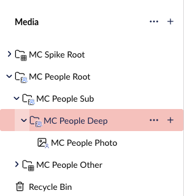

# People detection

Media Curator can decide whether each image shows people and mark those images in the backoffice media tree, so
editors can find them for privacy or model-release review. Every folder with such an image anywhere below it gets a
lighter mark, so the images can be found from the top of the tree down.

- Images that show people: a blue person sign (`icon-user`), labelled "Contains people".
- Folders with such images at any depth below them: a light blue people sign (`icon-users`), labelled "Contains images
  with people".

The signs appear only in the media tree. Umbraco's media grid and table views do not render entity signs.

## Turning it on

Settings › Media Curator › Setup › **Detect people**. It is off by default, and it needs **Use AI**.

## How images are checked

People detection never sends the image again. It decides from the description and tags that image analysis already
stored:

- **Fresh analysis** ("Analyze images", "Re-analyze image", curation that runs recognition, or the Automate "Analyze
  image" action): the decision is made right after the image is described.
- **Images analyzed before people detection was turned on**: "Analyze images" on a folder counts them as not
  analyzed yet. Running it keeps their stored analysis and only decides people from their stored description.
- **The People curation provider** decides for any image it sorts that has no current decision.

The decision engine follows the Setup's **Decision engine** setting:

- **Jev** (TypeSafe): one yes/no (Noul) question over the image summary and tags. Jev returns a probability; an image
  counts as showing people at 0.5 or above. Falls back to Umbraco.AI when no TypeSafe API key is set or the call fails.
- **Umbraco.AI**: one text-only call to the decision profile (or the description profile when no decision profile is
  set), asking for `{"containsPeople": true|false, "confidence": 0..1}`.

Real people count, including people seen in part, in the background or in a crowd, faces, and body parts such as hands.
Statues, mannequins, dolls, toys, cartoons, drawings and illustrations do not.

A decision is redone when the image's file is replaced, or when the image is analyzed again.

## Storage

Each decision is stored in the `mediaCuratorPeople` table: media key, whether it shows people, the confidence of that
answer (0–1), its source (`jev` or `umbraco-ai`), the item's tree path, the file it describes, and when it was made.

The media tree reads only this table, never the AI: one lookup of the page's tree paths and one database query per tree
page. Folder marks come from a path-prefix match against the stored paths.

Paths stay current as media moves. Moving an item, moving it to the recycle bin, or restoring it rewrites the stored
path of the item and of everything below it. Deleting media removes its decisions and those of everything below it. A
decision kept in the recycle bin comes back with a restored image, with no new AI call.

## Badges refreshing

After "Analyze images" with people detection on, and after "Curate images", every tree branch above the affected
items reloads, so the marks update without reloading the page.

## Limitations

- The decision is made from the stored description and tags, not the pixels. A person the description leaves out (for
  example someone small in the background of a landscape) is missed.
- Turning **Detect people** off hides the marks; stored decisions are kept for when it is turned on again.
